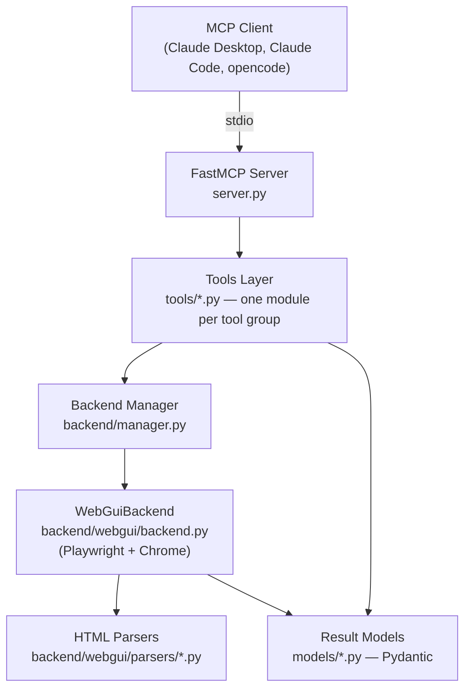
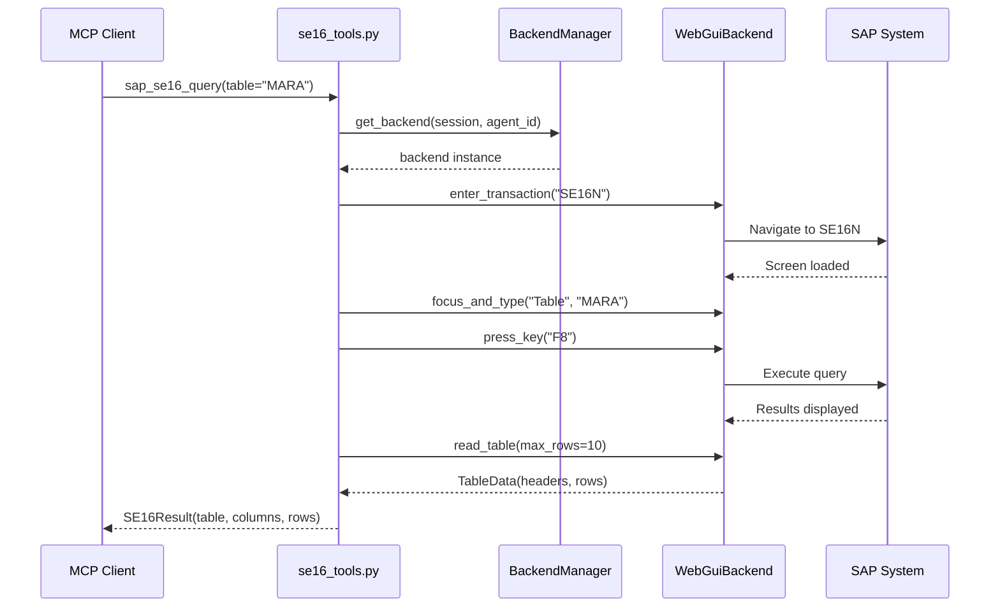

# Architecture

This document explains how the SAP MCP Server is structured so you can navigate the codebase, understand the request flow, and add new features without reading every file first.

## SAP in 30 Seconds

SAP Web GUI is the browser version of SAP GUI for interacting with SAP ERP systems. Users navigate by entering **transaction codes** (tcodes like `SE16`, `VA01`, `SM37`) into the **OK-Code field** and pressing Enter. Each transaction shows a different screen with fields, tables, and buttons. The **status bar** at the bottom shows success/error messages after each action.

This MCP server automates that interaction — it enters tcodes, fills fields, reads tables, and returns structured results. It does so by driving SAP Web GUI in Chrome with Playwright. There is exactly one backend, the `WebGuiBackend`. SAP GUI for Windows is not supported here; see [sapgui.mcp](https://github.com/Hochfrequenz/sapgui.mcp).

## Layers



### Layer Responsibilities

| Layer               | Key Files                                        | What It Does                                                                                                                                                  |
| ------------------- | ------------------------------------------------ | ------------------------------------------------------------------------------------------------------------------------------------------------------------- |
| **Server**          | `server.py`                                      | Creates the FastMCP app, registers all tools/resources/prompts, manages lifecycle                                                                             |
| **Tools**           | `tools/sap_tools.py`, `tools/se16_tools.py`, ... | Define MCP tools the LLM can call. Each tool gets the backend via `get_backend()` (typed `WebGuiBackend`), calls its methods, returns a Pydantic result model |
| **Backend Manager** | `backend/manager.py`                             | Singleton that creates/caches the WebGUI backend. Routes session IDs to backend instances                                                                     |
| **WebGUI Backend**  | `backend/webgui/backend.py`, `browser.py`        | Playwright page automation (`WebGuiBackend`). Fills fields with JavaScript, reads screens with ARIA snapshots                                                 |
| **Parsers**         | `backend/webgui/parsers/*.py`                    | WebGUI-specific HTML-to-structured-data extraction. One parser per transaction (e.g., `se16_parser.py`, `se24_parser.py`)                                     |
| **Models**          | `models/*.py`                                    | Pydantic models for tool results, screen state, and config. Result models never import from backend or tools                                                  |

## Request Flow

What happens when the LLM calls `sap_se16_query(table="MARA", max_hits=10)`:



## File Organization

Core packages only — helper packages (`catalog/`, `classcatalog/`, `fmcatalog/`, `tables/`) provide offline SAP metadata search; `middleware/`, `resources/`, `prompts/`, `skills/`, `loghandlers/` handle cross-cutting concerns; `lang/` holds the language packs (see below); `data/` holds the offline catalogs and the SAP knowledge base.

```
src/sapwebguimcp/
  server.py                    # FastMCP app, tool registration, lifecycle
  models/
    config.py                  # SapGuiSettings (server env vars) and the systems.json loader
    base.py                    # ToolResult base class, TCode type, PopupInfo
    sap_results.py             # Shared results (LoginResult, ScreenInfo, ...)
    se16_models.py             # SE16-specific result models
    se24_models.py             # SE24-specific result models
    ...                        # One model file per transaction
  backend/
    manager.py                 # Backend factory + session routing
    webgui/
      backend.py               # WebGuiBackend implementation
      browser.py               # Chrome/Playwright lifecycle management
      chrome_finder.py         # Auto-detect the Chrome installation (Windows only)
      js_helpers.py            # JavaScript helper loader
      models/                  # browser_results, session_registry
      types.py                 # AriaSnapshot
      js/*.js                  # Injected JS for field filling, screen reading
      parsers/                 # HTML → structured data (one per transaction)
  tools/
    sap_tools.py               # Core tools: login, transaction, screen, keyboard, ...
    se16_tools.py              # SE16N data browser (query tables)
    se24_tools.py              # SE24 class lookup
    se24_edit_tools.py         # SE24 class source editing
    se37_tools.py              # SE37 function module lookup
    se37_edit_tools.py         # SE37 function module editing
    se38_edit_tools.py         # SE38 report editing
    ...                        # More transaction tools (se09, se11, se93, sm30, sm37, slg1, spro, st22)
    field_helpers.py           # Shared field-filling logic
    session_tools.py           # Multi-session management (list/close/bind/release/reset; detach is unsupported)
    feedback_tools.py          # LLM feedback logging → GitHub issues
```

## SAP UI Texts and Language Packs

Every text the server reads from or types into an SAP screen (button labels, tab titles, window
titles, status-bar messages, column headers) depends on the SAP logon language. These texts live
only in the language packs under `src/sapwebguimcp/lang/` (`de.py`, `en.py`, schema in `schema.py`);
the session language is set at login and `lang.current()` returns the matching merged view (session
pack, then EN). Design and rationale:
[`docs/superpowers/specs/2026-11-10-language-packs-design.md`](docs/superpowers/specs/2026-11-10-language-packs-design.md).

**The rule: no SAP UI literal outside `lang/`.** Tool, parser and JS code reads a `Text`,
`RegexText` or `Template` from the pack (`contains`, `equals`, `alt`, `pattern`, `for_js()`) and
never spells a screen text itself.

Guards:

- `unittests/test_no_ui_literals.py` scans `src/sapwebguimcp` (Python and the JS in `backend/webgui/js`)
  for literals that look like SAP screen text. Fix a hit by moving the text into the packs (and a
  `SOURCES` entry in `lang/sources.py`), or, if it is code or the server's own message, mark the
  exact line with `# lang-ok: <reason>` (`// lang-ok: <reason>` in JS). The baseline
  `unittests/lang_baseline.json` is shrink-only and empty.
- `unittests/lang/` checks pack completeness, flag consistency, regex/JS portability, and
  `test_pseudo_locale.py` round-trips a pseudo pack (every text replaced by a marker) through its
  helpers (`unittests/webgui/test_pseudo_locale_parsers.py` runs the parsers against it).

### Backend tags and the JavaScript machinery

`lang/backends.py` tags every pack field as `WEBGUI` (only the WebGUI code reads it) or `BOTH` (shared
code reads it); the enum still has a `DESKTOP` member that no field uses any more.
`unittests/lang/test_backend_tags.py` derives the tag from the source and fails on a missing or wrong tag
and on unused fields. Pack texts reach the browser through `for_js()` and the Node runner of the JS pack
tests; the pieces are listed in
[`ADDING_A_LANGUAGE.md`](src/sapwebguimcp/lang/ADDING_A_LANGUAGE.md#javascript-and-node-machinery).

### Adding a login language

The full guide, including what to look out for (mixed-language screens, release differences,
case sensitivity, short fragments), is
[`src/sapwebguimcp/lang/ADDING_A_LANGUAGE.md`](src/sapwebguimcp/lang/ADDING_A_LANGUAGE.md). In short:

1. Draft the pack: `uv run python scripts/harvest_lang_texts.py <XX> --draft --out src/sapwebguimcp/lang/<xx>.py`
   on a system that has the language installed. Sourced texts come from SAP; everything else keeps
   the EN value with a `# TODO`. Set `html_lang`, `logon_dropdown` and `date_format`.
2. Register the pack in `src/sapwebguimcp/lang/__init__.py` (`_PACKS`); `--verify` and the config
   accept only registered codes.
3. Settle every `TODO` from SAP (`--print-sql` lists the queries; mypy and
   `unittests/lang/test_pack_completeness.py` list the gaps). Texts that are deliberately identical
   to EN go into `same_as_en`.
4. Verify against SAP's text tables on every release:
   `uv run python scripts/harvest_lang_texts.py <XX> --verify`. Fix every drift or mark the field
   `Manual` with a reason.
5. Fill the test pack (`unittests/testdata/lang_test.py`), record fixtures with
   `SAP_LANGUAGE=<XX>`, run `uv run --group tests pytest unittests/lang unittests/test_no_ui_literals.py`,
   then the live tests logged on in the new language.

## How to Add a New Transaction Tool

Follow the SE16 pattern. For a new transaction `SE99`:

### 1. Create the result model

`src/sapwebguimcp/models/se99_models.py`:

```python
from pydantic import Field
from sapwebguimcp.models.base import ToolResult

class SE99Result(ToolResult):
    """Result from sap_se99_query tool."""
    data: list[dict[str, str]] = Field(default_factory=list)
    # Add transaction-specific fields
```

Export it from `models/__init__.py`.

### 2. Create the tool file

`src/sapwebguimcp/tools/se99_tools.py`:

```python
from fastmcp import FastMCP
from sapwebguimcp.backend.manager import get_backend
from sapwebguimcp.models.se99_models import SE99Result

def register_se99_tools(mcp: FastMCP) -> None:
    @mcp.tool(description="Query SE99 data")
    async def sap_se99_query(
        param: str,
        session: str | None = None,
        agent_id: str | None = None,
    ) -> SE99Result:
        backend = await get_backend(session=session, agent_id=agent_id, tool_name="sap_se99_query")

        # Navigate
        tx = await backend.enter_transaction("SE99")
        if not tx.success:
            return SE99Result.failure(f"Navigation failed: {tx.error}")

        # Fill fields, execute, read results
        await backend.fill_field("Field Label", param)
        await backend.press_key("F8")
        # ... parse results ...

        return SE99Result(data=[...])
```

### 3. Add a WebGUI parser (if needed)

`src/sapwebguimcp/backend/webgui/parsers/se99_parser.py` — for extracting structured data from HTML/ARIA snapshots.

### 4. Register the tool

In `server.py`, add the import and call `register_se99_tools(mcp)` alongside the existing registrations. Also export the registration function from `tools/__init__.py`.

### 5. Add tests

- `unittests/test_se99_models.py` — model validation (offline)
- `unittests/webgui/test_se99_parser.py` — parser test against an HTML snapshot (offline)
- `unittests/webgui/test_se99_integration.py` — integration test (needs SAP, auto-skipped)

## Tests

### Categories

Tests are marked `integration` automatically when they use the live SAP fixture (`sap_mcp_client`), not by file name; file names below are only examples.

| Category               | Examples                                                                          | Needs SAP?       | How to run                                                              |
| ---------------------- | --------------------------------------------------------------------------------- | ---------------- | ----------------------------------------------------------------------- |
| **Root unit tests**    | `unittests/test_models.py`, `test_config.py`, `test_catalog.py`, ...              | No               | `uv run --group tests python -m pytest unittests/ -m "not integration"` |
| **WebGUI unit tests**  | `unittests/webgui/test_se16_parser.py`, `test_selectors.py`, ... (HTML snapshots) | No               | `uv run --group tests python -m pytest unittests/ -m "not integration"` |
| **WebGUI integration** | `unittests/webgui/test_se16_integration.py`, `test_*_exploration.py`, ...         | Yes (SAP WebGUI) | `uv run --group tests python -m pytest unittests/ -m integration`       |

### Where a test lives

- A test that imports `sapwebguimcp.backend.webgui` lives in `unittests/webgui/`.
- Tests that need no backend stay in `unittests/` and `unittests/lang/`.
- Assets shared by several tests sit in `unittests/testdata/` (`lang_test.py`, `html_snapshots/`, the abapGit submodules in `abapgit_repos/`).
- The release smoke test of the binary is `scripts/smoke_test_exe.py`.

### Skip Mechanism

Integration tests auto-skip based on **credential detection** — no hardcoded hostnames or machine lists.

- **WebGUI tests** use `has_sap_webgui_creds()` (defined in `unittests/conftest.py`): skips when SAP credentials are not configured in `~/.config/sap-mcp/systems.json`
- Configure your `systems.json` file and the tests run automatically

### Running Tests

```bash
uv run --group tests python -m pytest                                    # Full suite (integration auto-skips without SAP)
uv run --group tests python -m pytest unittests/ -m "not integration"    # All offline tests (no SAP needed)
uv run --group tests python -m pytest unittests/ -m integration          # SAP integration tests only
uv run --group linting ruff check .                                      # ruff lint
uv run --group type_check mypy --show-error-codes src/sapwebguimcp --strict # mypy --strict
uv run --group linting ruff format --check .                             # ruff format check
```

## Configuration

All settings are in `src/sapwebguimcp/models/config.py` and loaded from environment variables or `.env` files.

SAP credentials (user, password, client, language, host) are loaded from `~/.config/sap-mcp/systems.json` (or the path set via `SAP_CONFIG_FILE`). See the [sap-mcp-config](https://github.com/Hochfrequenz/sap-mcp-config) package. `SAP_URL` (Web GUI URL, for example `https://server/sap/bc/gui/sap/its/webgui`) is only a fallback for systems without a `host`.

### Optional

| Group       | Variables                                                                                            | Purpose                                     |
| ----------- | ---------------------------------------------------------------------------------------------------- | ------------------------------------------- |
| **Browser** | `BROWSER_MODE`, `BROWSER_TYPE`, `CDP_URL`, `CHROME_PATH`, `CHROME_USER_DATA_DIR`, `BROWSER_HEADLESS` | Chrome/Playwright configuration             |
| **GitHub**  | `GITHUB_PAT`, `GITHUB_USER`, `GITHUB_REPO`, `ABAPGIT_PAT`                                            | Feedback issue creation, abapGit operations |
| **Other**   | `OUTPUT_DIR`, `LOG_FORMAT`, `LOG_LEVEL`                                                              | Sandbox for `output_file`, logging          |

See `.env.example` for a complete template with descriptions.
