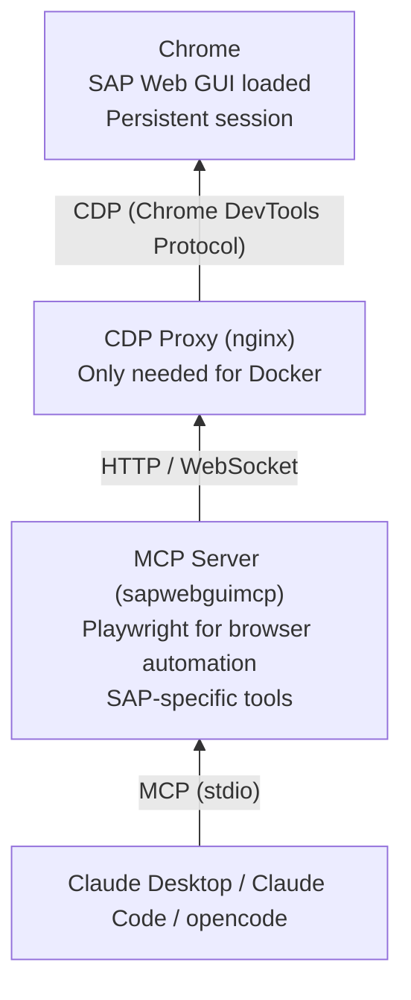

Looking for a maintainer. This project may not receive updates. For SAP GUI for Windows, use [sapgui.mcp](https://github.com/Hochfrequenz/sapgui.mcp).

# SAP Web GUI MCP Server

[](https://github.com/Hochfrequenz/sapwebgui.mcp/actions)
[](https://github.com/Hochfrequenz/sapwebgui.mcp/actions)
[](https://github.com/Hochfrequenz/sapwebgui.mcp/actions)
[](https://github.com/Hochfrequenz/sapwebgui.mcp/actions)

An MCP (Model Context Protocol) server that lets an AI agent work in **SAP Web GUI**.
It controls SAP through a Chrome browser, so it runs on Windows, macOS and Linux.
You use it from Claude Desktop, Claude Code, or [opencode](https://opencode.ai).
Because it drives the real SAP UI (not a headless API), it is especially well-suited for **end-to-end testing**, **visual validation**, and **capturing screenshots for documentation**.
The MCP server works with both SAP R/3 and S/4.

Because every SAP screen is a browser tab, the agent can also switch to another tab while the first one is still updating, which allows concurrent workflows (see `sap_session_bind` in [Capabilities](#capabilities)).

### Pairing with other MCPs

You can pair this GUI MCP with an ADT MCP like [`aibap.mcp`](https://github.com/Hochfrequenz/aibap.mcp).
ADT MCPs and this GUI MCP complement each other in a two-agent vibe-coding setup: one agent writes ABAP via ADT, while a second agent drives this server to test the generated code in the real SAP UI, captures screenshots, and reports failures back.

### Language-specific behaviour for some transactions

The core of this MCP is _not_ language-specific, meaning it generally works with any SAP logon language.
However, there is also built-in support for specific transactions like `SE16` or `ST22`.
These transaction-specific tools only work for certain logon languages, because the MCP server relies on button or column labels, which vary by language.
We support English (`EN`), German (`DE`) and Italian (`IT`).

### Under the hood

Are you a developer?
Read [ARCHITECTURE.md](ARCHITECTURE.md) for codebase structure, request flow diagrams, and how to add new transaction tools.
[CONTRIBUTING.md](CONTRIBUTING.md) covers running from source, tests and code style.

## Setup

Setup is a linear path of five steps:

1. [Install the server](#step-1-install-the-server) (standalone executable, Docker, or from source).
2. [Create the SAP config file `systems.json`](#step-2-create-the-sap-config-file-systemsjson).
3. [Start Chrome with remote debugging](#step-3-start-chrome-with-remote-debugging).
4. [Register the server with your MCP client](#step-4-register-the-server-with-your-mcp-client) (Claude Code, Claude Desktop or opencode).
5. [Verify the setup](#step-5-verify-the-setup) and try a first prompt.

Docker users follow the [Docker section](#docker) instead of steps 1, 3 and 4.

**Before you start, you need:**

- Google Chrome (the server drives it through the Chrome DevTools Protocol, CDP).
- A VPN connection, if your SAP system is on an internal network.
- Your SAP system's Web GUI must be reachable in a browser at `https://<host>/sap/bc/gui/sap/its/webgui` and you must be able to log in there with user and password. Ask your SAP Basis team to activate the ICF service `/sap/bc/gui/sap/its/webgui` if it is not.

> [!NOTE]
> **Why a separate credentials file?** Most MCP servers put SAP credentials directly in the per-project MCP config (`env` block), which means re-entering them for every project.
> Here, credentials and SAP settings live in a single shared file (`systems.json`) that all Hochfrequenz SAP MCP servers read automatically - so this server and [`aibap.mcp`](https://github.com/Hochfrequenz/aibap.mcp) both work with the same credentials without duplication.
> You **can** store credentials in plain text, but you can also refer to an environment variable.

> [!WARNING]
> **Special characters in passwords stored in a `.json` file:** If your SAP password contains `"` or `\` characters, you must escape them in the JSON config files: `"` becomes `\"` and `\` becomes `\\`. For example, `pass"word` becomes `"pass\"word"` and `do\main` becomes `"do\\main"`. Unescaped special characters will silently break the JSON and the MCP server will fail to start.

> [!TIP]
> **Windows file extensions:** If file extensions are hidden in Windows Explorer, creating `.mcp.json` via right-click → New → Text File will produce `.mcp.json.txt` (or `.mcp.json.json` if you rename). Make sure "File name extensions" is checked in Explorer's View tab, then rename the file.

### Step 1: Install the server

Pick one way to get the server. Each release on [GitHub Releases](https://github.com/Hochfrequenz/sapwebgui.mcp/releases/latest) provides standalone executables and a Docker image.

#### Option A: Standalone executable (Windows, macOS - no Python needed)

Download the binary for your platform from [GitHub Releases](https://github.com/Hochfrequenz/sapwebgui.mcp/releases/latest):

| Platform              | Binary                                |
| --------------------- | ------------------------------------- |
| Windows (x64)         | `sapwebgui_mcp_windows_<version>.exe` |
| macOS (Apple Silicon) | `sapwebgui_mcp_macos_arm64_<version>` |

Each release also lists `checksums.txt` (SHA-256 of the binaries).
Save the binary somewhere permanent and **note its full path**. You need it in [Step 4](#step-4-register-the-server-with-your-mcp-client). For example, if you saved `sapwebgui_mcp_windows_<version>.exe` to your Downloads folder, the path is `C:/Users/YourName/Downloads/sapwebgui_mcp_windows_<version>.exe`. Always use forward slashes (`/`) in JSON, not backslashes (`\`).

**Windows blocks the `.exe`?** Windows may flag an executable as downloaded from another computer.
If you trust the file downloaded from our GitHub Releases, right-click it → **Properties** (**Eigenschaften**) → **General** (**Allgemein**).
Under **Security** (**Sicherheit**), check **Unblock** (**Zulassen**), then **Apply** (**Übernehmen**) and try again.
The checkbox only appears when Windows has marked the file as downloaded from another computer. This removes that download block; it does not override Smart App Control.
If Smart App Control still blocks execution, contact your IT administrator rather than disabling protection.


**macOS Gatekeeper:** If macOS refuses to run the binary, clear the quarantine attribute and make it executable: `xattr -c sapwebgui_mcp_macos_arm64_<version>` and `chmod +x sapwebgui_mcp_macos_arm64_<version>`.

There is no Linux binary. On Linux, use [Option B](#option-b-from-source-all-operating-systems) or [Docker](#docker).

The executable cannot start its own Playwright browser: it only supports `BROWSER_MODE=connect` (your own Chrome).

#### Option B: From source (all operating systems)

You need [uv](https://docs.astral.sh/uv/getting-started/installation/) (it installs the right Python for you).

```bash
git clone https://github.com/Hochfrequenz/sapwebgui.mcp.git
cd sapwebgui.mcp
uv sync
```

This creates a virtual environment in `.venv` with the command `run-sapwebgui-mcp-server`. **Note the full path of that command**; you need it in [Step 4](#step-4-register-the-server-with-your-mcp-client):

| OS            | Path of the command                                                   |
| ------------- | --------------------------------------------------------------------- |
| Windows       | `C:/path/to/sapwebgui.mcp/.venv/Scripts/run-sapwebgui-mcp-server.exe` |
| macOS / Linux | `/path/to/sapwebgui.mcp/.venv/bin/run-sapwebgui-mcp-server`           |

To update later, run `git pull` and `uv sync` again.
Contributors: see [CONTRIBUTING.md](CONTRIBUTING.md) for the development setup.

### Step 2: Create the SAP config file (`systems.json`)

This file holds your SAP systems and credentials. It is shared with [aibap.mcp](https://github.com/Hochfrequenz/aibap.mcp) - configure it once and all Hochfrequenz SAP MCP servers will use it. The file format is owned by [sap-mcp-config](https://github.com/Hochfrequenz/sap-mcp-config); see there for the complete field reference, validation rules and YAML support.

The default location is:

| OS          | Default path                                 |
| ----------- | -------------------------------------------- |
| Windows     | `%USERPROFILE%\.config\sap-mcp\systems.json` |
| macOS/Linux | `~/.config/sap-mcp/systems.json`             |

On **Windows**, open Windows Explorer and paste `%USERPROFILE%\.config\sap-mcp` into the address bar. Create the folder if it doesn't exist, then create a file called `systems.json` inside it. (Set `SAP_CONFIG_FILE` to use another path.)

```json
{
    "default_system": "dev",
    "systems": {
        "dev": {
            "host": "https://your-sap-server:44300",
            "client": "100",
            "user": "your_username",
            "password": "your_password",
            "language": "DE"
        }
    }
}
```

- The **dictionary key** (`"dev"`) is the system key. The agent passes it as `system_key` to `sap_login`, and `default_system` names the key used when none is given.
- `host` is the base URL of your SAP system. The server derives the Web GUI URL `{host}/sap/bc/gui/sap/its/webgui` from it. If your system uses a different Web GUI path, ask the agent to log in with that full URL (`sap_login` has a `url` parameter).
- `language` must be `DE`, `EN` or `IT` (omitted means `EN`).
- You do **not** need `connection_name` (that field belongs to SAP Logon, which this server does not use).

> [!NOTE]
> If your SAP system uses a self-signed or internally-signed certificate (common for VPN/intranet systems), add `"tls_skip_verify": true` to the system entry. Leave it out if your system has a publicly-trusted certificate. Chrome itself is started with `--ignore-certificate-errors` in [Step 3](#step-3-start-chrome-with-remote-debugging).

> [!IMPORTANT]
> After editing `systems.json`, restart Claude Desktop, Claude Code, or opencode for the changes to take effect.

> [!TIP]
> **Don't want your password sitting in the file?** A system's string fields - `host`, `client`, `user`, `password`, `language`, `oauth2_client_id` - may reference an environment variable instead, using `${env:VAR}`:
>
> ```json
> "user": "${env:SAP_DEV_USER}",
> "password": "${env:SAP_DEV_PASSWORD}"
> ```
>
> The file then holds only structure - which systems exist and their hosts - so it is safe to commit and share with your team, while the credentials come from your environment or password manager. If a referenced variable is unset or empty, the first tool call that needs a credential - `sap_login`, for instance - fails with an error naming the variable, rather than logging in with an empty password.

For several systems, add more entries under `systems`. The agent then lets you choose one (the `choose` tool) and logs in with `sap_login(system_key="qa")`. If the system key is not found, an error lists the available keys.

### Step 3: Start Chrome with remote debugging

The server controls a Chrome browser that you can see. Chrome must run with remote debugging enabled on port 9222 and with its own profile directory (`--user-data-dir`; without it Chrome joins your running Chrome and ignores the debugging flag).

**Windows:**

```powershell
& "C:\Program Files\Google\Chrome\Application\chrome.exe" --remote-debugging-port=9222 --user-data-dir="C:\temp\chrome-debug" --ignore-certificate-errors
```

If Chrome was installed only for your user, use `"$env:LOCALAPPDATA\Google\Chrome\Application\chrome.exe"` instead. If the command fails, see [Finding your Chrome path](#finding-your-chrome-path).

**macOS:**

```bash
/Applications/Google\ Chrome.app/Contents/MacOS/Google\ Chrome --remote-debugging-port=9222 --user-data-dir="/tmp/chrome-debug" --ignore-certificate-errors
```

**Linux:**

```bash
google-chrome --remote-debugging-port=9222 --user-data-dir=/tmp/chrome-debug --ignore-certificate-errors
```

Leave this Chrome window open. Check that it works (open `http://localhost:9222/json/version` in another browser, or run):

```powershell
Invoke-WebRequest -Uri 'http://localhost:9222/json/version' -UseBasicParsing
```

On macOS/Linux: `curl http://localhost:9222/json/version`. You should see JSON. If you get a connection error, make sure you included `--user-data-dir`.

> [!NOTE]
> **On Windows this step is optional.** If no Chrome answers on port 9222, the server finds Chrome and starts it with these flags itself (profile directory `CHROME_USER_DATA_DIR`, default `<tempdir>/chrome-debug`; set `CHROME_PATH` if Chrome is not found). On macOS and Linux the server cannot start Chrome: you must start it yourself.

If your Chrome listens on another port, set `CDP_URL` (see the [environment variables](#environment-variables-server-specific)).

### Step 4: Register the server with your MCP client

Register the server once with the client you use. The server name is up to you; this guide uses `sap-webgui`. Below, `<command>` is the full path you noted in [Step 1](#step-1-install-the-server) (the `.exe`, the macOS binary, or the `run-sapwebgui-mcp-server` command of your source checkout).

#### Claude Code

**Recommended: register once for all projects (user scope).** Run this in PowerShell, bash or zsh:

```powershell
claude mcp add --scope user sap-webgui '--' C:/path/to/sapwebgui_mcp_windows_<version>.exe
```

Together with `systems.json`, this is all Claude Code needs - no `.mcp.json` in any project folder. Two details matter:

- **Keep the server name (`sap-webgui`) before `-e`.** The `-e` option accepts several values, so a name placed after it is read as a second environment variable and the command fails with `error: missing required argument 'commandOrUrl'`.
- **Keep the quotes around `'--'`.** If Claude Code was installed through npm, `claude` is a PowerShell script, and PowerShell silently drops an unquoted `--` before passing the arguments on. `-e` then swallows the executable path and the command fails with the same error. This works in PowerShell, bash and zsh (in bash or zsh, `'--'` and `--` are equivalent). In cmd.exe, single quotes are not quoting characters, so write a plain `--` instead.

On macOS or Linux, use your `<command>` path instead of the `.exe` path. If Claude Code still starts an old or broken registration instead of the global one, see [Claude Code ignores the global registration](#claude-code-ignores-the-global-registration).

**Alternative: per project.** Add to `.mcp.json` in your project root:

```json
{
    "mcpServers": {
        "sap-webgui": {
            "command": "C:/path/to/sapwebgui_mcp_windows_<version>.exe",
            "args": [],
            "env": {}
        }
    }
}
```

#### Claude Desktop

Add to `claude_desktop_config.json`. On Windows, press **Win+R**, type `%APPDATA%\Claude` and press Enter. On macOS the file is `~/Library/Application Support/Claude/claude_desktop_config.json`. If `claude_desktop_config.json` does not exist, create a new text file with that exact name (make sure it ends in `.json`, not `.json.txt`). If the file already has content, add `sap-webgui` to the existing `mcpServers` object.

```json
{
    "mcpServers": {
        "sap-webgui": {
            "command": "C:/path/to/sapwebgui_mcp_windows_<version>.exe",
            "args": [],
            "env": {}
        }
    }
}
```

Restart Claude Desktop after saving.

#### opencode

Add to `opencode.json` in your project root:

```json
{
    "$schema": "https://opencode.ai/config.json",
    "mcp": {
        "sap-webgui": {
            "type": "local",
            "command": ["C:/path/to/sapwebgui_mcp_windows_<version>.exe"],
            "enabled": true,
            "environment": {}
        }
    }
}
```

> [!TIP]
> In `opencode.json`, you can use either forward slashes (`C:/path/to/...`) or double-escaped backslashes (`C:\\path\\to\\...`) in the `command` path. Single backslashes will break the JSON silently.

#### Optional environment variables

Most setups need none. To set one (for example `CDP_URL`, `CHROME_PATH` or `GITHUB_PAT`, see the [environment variables](#environment-variables-server-specific)):

- **Claude Code (command line):** add `-e NAME=value` between the server name and `'--'`, for example `claude mcp add --scope user sap-webgui -e CDP_URL=http://localhost:9223 '--' <command>`.
- **Claude Code `.mcp.json` and Claude Desktop:** put it in the `env` object, for example `"env": { "CDP_URL": "http://localhost:9223" }`.
- **opencode:** put it in the `environment` object.
- Any client: a `.env` file in the working directory of the server process is read too, but that directory depends on how your client starts the server, so prefer the client config.

> [!NOTE]
> `GITHUB_PAT` is optional - only needed for `log_feedback` (creates GitHub issues) and abapGit operations with private repositories.

### Step 5: Verify the setup

Before your first prompt, check that the MCP server starts correctly. Open a terminal (PowerShell on Windows, Terminal on macOS/Linux) and run:

**Claude Code:**

```
claude mcp list
```

Expected output:

```
sap-webgui: C:/path/to/sapwebgui_mcp_windows_<version>.exe ✓ Connected
```

**opencode:**

```
opencode mcp list
```

Expected output:

```
● ✓ sap-webgui connected
```

If you see `✗ Failed`, the most common cause is a wrong path to the executable in your config. Double-check the path and that the file exists there. Run `opencode mcp debug sap-webgui` for more detail.

For Claude Code with a user-scope registration there is no config file to edit: `claude mcp get sap-webgui` shows the registered path, and to change it (for example after downloading a new version), run `claude mcp remove sap-webgui -s user` and add the server again.

> [!TIP]
> **Getting started:** Restart Claude Desktop, Claude Code, or opencode, make sure Chrome from [Step 3](#step-3-start-chrome-with-remote-debugging) is running (on Windows it starts automatically if it is not), then try: _"Log me into SAP"_, _"Run transaction SE16"_ or _"Take a screenshot of the current SAP screen"_. If the agent tries to start another browser tool or to _install_ Chrome, cancel and be explicit: "log me into SAP using the sap-webgui MCP server".

### Docker

Use Docker instead of steps 1, 3 and 4 if you prefer not to install the executable or Python. Steps 2 (`systems.json`) and 5 still apply. Because the server then runs in a container, it cannot reach Chrome on your host directly, so a small CDP proxy is needed.

**Prerequisites:** [Docker Desktop](https://www.docker.com/products/docker-desktop/), Chrome, and a VPN connection if your SAP system is on an internal network. Verify Docker is running:

```powershell
docker --version
```

**1. Start Chrome with remote debugging** as in [Step 3](#step-3-start-chrome-with-remote-debugging). In Docker the server cannot auto-launch Chrome, so you must do this yourself.

**2. Set up the CDP proxy.** Chrome rejects CDP connections whose `Host` header is not `localhost`, and a container reaches your host as `host.docker.internal`. The proxy rewrites the header. Create a folder (e.g., `C:\sap-mcp\`) and add these two files:

**docker-compose.yml**

```yaml
services:
    cdp-proxy:
        image: nginx:alpine
        ports:
            - '9223:9222'
        volumes:
            - ./nginx-cdp-proxy.conf:/etc/nginx/conf.d/default.conf:ro
        restart: unless-stopped

networks:
    default:
        name: sap-mcp-network
```

**nginx-cdp-proxy.conf**

```nginx
server {
    listen 9222;

    resolver 127.0.0.11 valid=30s;

    location / {
        set $backend "host.docker.internal:9222";
        proxy_pass http://$backend;
        proxy_set_header Host localhost;
        proxy_http_version 1.1;
        proxy_set_header Upgrade $http_upgrade;
        proxy_set_header Connection "upgrade";

        proxy_read_timeout 3600s;
        proxy_send_timeout 3600s;

        sub_filter 'ws://localhost/' 'ws://host.docker.internal:9223/';
        sub_filter 'ws://localhost:9222/' 'ws://host.docker.internal:9223/';
        sub_filter_once off;
        sub_filter_types application/json;
    }
}
```

Then start the proxy:

```powershell
cd C:\sap-mcp
docker compose up -d
```

Verify it's running:

```powershell
docker ps --filter "name=cdp-proxy" --format "table {{.Names}}\t{{.Status}}"
```

**3. Register the container with your MCP client.** The image is `ghcr.io/hochfrequenz/sapwebgui.mcp:latest`. `systems.json` is mounted into the container. Replace:

- `C:/Users/YourName` with your home folder (on macOS, use `/Users/YourName/...`). Docker treats a mount source that is not an absolute path as the name of a Docker volume, so `~` does not work here.
- `your_github_pat` with a [GitHub Personal Access Token](https://github.com/settings/tokens), or remove the `GITHUB_PAT` lines if you do not need that feature (see the note under [Optional environment variables](#optional-environment-variables)).

_Claude Desktop_ (`claude_desktop_config.json`, see [Claude Desktop](#claude-desktop) for its location):

```json
{
    "mcpServers": {
        "sap-webgui": {
            "command": "docker",
            "args": [
                "run",
                "-i",
                "--rm",
                "--network",
                "sap-mcp-network",
                "-e",
                "BROWSER_MODE=connect",
                "-e",
                "CDP_URL=http://cdp-proxy:9222",
                "-v",
                "C:/Users/YourName/.config/sap-mcp/systems.json:/home/appuser/.config/sap-mcp/systems.json:ro",
                "-e",
                "GITHUB_PAT=your_github_pat",
                "ghcr.io/hochfrequenz/sapwebgui.mcp:latest"
            ]
        }
    }
}
```

_Claude Code_ (user scope, run once):

```powershell
claude mcp add --scope user sap-webgui '--' docker run -i --rm --network sap-mcp-network -e BROWSER_MODE=connect -e CDP_URL=http://cdp-proxy:9222 -v C:/Users/YourName/.config/sap-mcp/systems.json:/home/appuser/.config/sap-mcp/systems.json:ro -e GITHUB_PAT=your_github_pat ghcr.io/hochfrequenz/sapwebgui.mcp:latest
```

Everything after `'--'` is the Docker command and is passed through unchanged, so the `-e` flags there are Docker's, not Claude Code's. Keep the quotes around `'--'` (in cmd.exe, write a plain `--`; see [Claude Code](#claude-code) for why). Write the home folder path out in full instead of using `~`, because how `~` is expanded on the command line depends on the shell. A `GITHUB_PAT` typed on the command line ends up in your shell history. For a per-project registration, use the same `command` and `args` in `.mcp.json`; for opencode use `"command": ["docker", "run", ...]` with the same arguments.

If Docker Desktop isn't running, or you aren't logged in to `ghcr.io` and never pulled the image, you might get a nonspecific error "1 MCP server failed · /mcp". Try pulling manually (and see [Docker image pull fails](#docker-image-pull-fails)):

```powershell
docker pull ghcr.io/hochfrequenz/sapwebgui.mcp:latest
```

If the containers started but Chrome is missing, the agent will likely understand how to log in but fail on the first tool call.

## Capabilities

<a id="available-tools"></a>

Your AI client automatically discovers all individual tools and their schemas upon connection. At a high level, the server gives your agent:

- **Drive Any SAP Transaction** — Execute transaction codes (`sap_transaction`), fill form fields (`sap_fill_form`, `sap_set_field`, checkboxes, radio buttons, dropdowns), click buttons, press keys, select tabs, read and interact with ALV grids and tables, and handle modal popups and status bar messages.
- **Transaction Shortcuts** — Built-in tools for common developer and basis tasks: query tables (SE16/SE16N), inspect transports (SE09), search background jobs (SM37), inspect short dumps (ST22), query application logs (SLG1), read table maintenance views (SM30), look up Data Dictionary objects (SE11), classes (SE24), function modules (SE37) and transactions (SE93), and search the IMG (SPRO). `sap_quick_report` runs a report in one call: it enters the transaction, fills the selection screen, presses Execute and reads the result.
- **Editing ABAP in SAP** — `sap_se38_edit`, `sap_se37_edit` and `sap_se24_edit` change existing reports, function modules and class methods in place. Prefer abapGit or an ADT MCP where you can.
- **Visual Validation & Screenshots** — `sap_screenshot` captures any SAP screen for documentation, E2E test verification, or human-in-the-loop inspection.
- **Offline Catalogs** — `search_transactions`, `search_tables`, `search_classes` and `search_function_modules` search without an active SAP connection.
- **abapGit & Source Code** — Pull abapGit repositories (`sap_abapgit_pull`, `sap_abapgit_list_repos`) and read ABAP report source code (`sap_read_se38_source`). Pulls use the [`Z_ABAPGIT_PULL_MCP_SHORTCUT`](https://github.com/Hochfrequenz/Z_ABAPGIT_PULL_MCP_SHORTCUT) report on the SAP system. For private repositories, set `GITHUB_PAT` or `ABAPGIT_PAT`. `sap_abapgit_pull` takes an optional `branch` (e.g. `main`, `feature/x`): it switches the registered repository to that branch persistently (kept only if the pull succeeds) and clears a commit pin; the result's `branch` and `sap_abapgit_list_repos` show where the repository is. Instead of `repo`, `sap_abapgit_pull` accepts `key` (the 12-digit repository key from `sap_abapgit_list_repos`), the only unique identifier when two repositories share a name or URL; it needs a report version with `P_KEY`.
- **Multi-Session Management** — Every SAP session is a browser tab. List, bind, release, close, and reset parallel sessions across concurrent agent tasks (`sap_session_list`, `sap_session_bind`, `sap_session_release`, `sap_session_close`, `sap_session_reset_to_primary`). `sap_session_detach` exists but is not supported (it always returns an error): use `sap_session_close`.
- **Browser Automation** — Low-level browser actions (`browser_click`, `browser_fill`, `browser_keyboard`, `browser_snapshot`, `browser_screenshot`, `browser_evaluate`, ...) are available as escape hatches for pixel-level control.
- **Prompts** — Ready-made workflows the client can offer: `create_business_partner`, `explore_table`, `explore_class`, `explore_function_module`, `se16_bulk_read` and `abapgit_workflow`.

## Configuration Reference

### SAP Credentials (via `systems.json`)

SAP credentials (user, password, client, language, host) are configured in `systems.json` (or `systems.yaml`), **not** via server environment variables. See [sap-mcp-config](https://github.com/Hochfrequenz/sap-mcp-config) for the file format. Override the config file path with `SAP_CONFIG_FILE`. The `language` of each system must be `DE`, `EN` or `IT` (case-insensitive; omitted means `EN`) - these are the languages this server supports, and any other value, such as `FR`, is rejected when the config is loaded with `language must be one of "DE", "EN", "IT"`. The variables `SAP_USER`, `SAP_PASSWORD`, `SAP_MANDANT`, `SAP_LANGUAGE`, `SAP_CONNECTION_NAME` and `SAP_CREDENTIALS` that some older MCP setups used are ignored by the server and can be removed from existing configs (`SAP_LANGUAGE` is read by the integration tests only).

Individual fields may still be sourced from the environment with an `${env:VAR}` placeholder - e.g. `"password": "${env:SAP_DEV_PASSWORD}"` - which keeps secrets out of the file while the structure stays in it. Placeholders work in `host`, `client`, `user`, `password`, `language`, `oauth2_client_id` and the top-level `default_system`.

An unset or empty variable makes the config invalid, so the first tool call that needs a credential - `sap_login`, for instance - fails with an error naming the variable, never a silently empty credential. Note that the server itself still starts: config loading is lazy, so the failure surfaces on first use rather than at launch. Tools that only _list_ configuration, such as `sap_list_connections`, do not fail on an invalid config but report the reason in a `config_error` field of their result instead of returning a silently empty list; the server instructions carry the same message. Text that only _looks_ like a placeholder is used verbatim, so a typo such as `${SAP_PASSWORD}` (missing the `env:` prefix) becomes your literal password rather than an error - see the [placeholder rules](https://github.com/Hochfrequenz/sap-mcp-config#keeping-secrets-out-of-the-config-file) for the exact forms.

| OS          | Default path                                 |
| ----------- | -------------------------------------------- |
| Windows     | `%USERPROFILE%\.config\sap-mcp\systems.json` |
| macOS/Linux | `~/.config/sap-mcp/systems.json`             |

### Environment Variables (server-specific)

All of these are optional. The server reads them from its process environment and from a `.env` file in its working directory.

| Variable               | Required                    | Description                                                                                                                                        | Default                          |
| ---------------------- | --------------------------- | -------------------------------------------------------------------------------------------------------------------------------------------------- | -------------------------------- |
| `SAP_URL`              | No                          | Fallback WebGUI URL, used only when the selected system has no `host` in systems.json (the URL is normally derived from `host`)                    | `""`                             |
| `SAP_CONFIG_FILE`      | No                          | Path to systems.json (see table above for default per OS)                                                                                          | (see above)                      |
| `OUTPUT_DIR`           | No                          | Directory that `output_file` tool arguments (e.g. `sap_se16_query`) are sandboxed to. Set this when the server's cwd isn't your project directory. | `""` (current working directory) |
| `BROWSER_MODE`         | No                          | `connect` (existing Chrome) or `launch` (Playwright starts a browser; needs `playwright install`, not available in the executable)                 | `connect`                        |
| `BROWSER_TYPE`         | No                          | `chromium`, `firefox`, or `webkit`                                                                                                                 | `chromium`                       |
| `BROWSER_HEADLESS`     | No                          | Run the browser in headless mode (applies to `BROWSER_MODE=launch`)                                                                                | `false`                          |
| `CDP_URL`              | When `BROWSER_MODE=connect` | Chrome DevTools Protocol URL                                                                                                                       | `http://localhost:9222`          |
| `CHROME_PATH`          | No                          | Explicit path to the Chrome binary. If empty, auto-detected (Windows only).                                                                        | `""` (auto-detect)               |
| `CHROME_USER_DATA_DIR` | No                          | User data directory for auto-launched Chrome                                                                                                       | `<tempdir>/chrome-debug`         |
| `GITHUB_PAT`           | No                          | GitHub PAT for `log_feedback` issues and abapGit auth                                                                                              | -                                |
| `GITHUB_USER`          | No                          | GitHub username for abapGit (falls back to `x-access-token`)                                                                                       | -                                |
| `GITHUB_REPO`          | No                          | Repository for feedback issues                                                                                                                     | `Hochfrequenz/sapwebgui.mcp`     |
| `ABAPGIT_PAT`          | No                          | Separate PAT for abapGit (overrides `GITHUB_PAT` if set)                                                                                           | -                                |
| `LOG_FORMAT`           | No                          | Set to `json` for JSON log output                                                                                                                  | `""` (human-readable)            |
| `LOG_LEVEL`            | No                          | `DEBUG`, `INFO`, `WARNING`, or `ERROR`                                                                                                             | `INFO`                           |

### Legacy `BACKEND_TYPE` setting

Earlier versions of the combined project selected their backend with `BACKEND_TYPE`. This server has only the Web GUI backend and does not read that variable. Only one value is noticed, to help users who still have an old configuration: if `BACKEND_TYPE` is `desktop` (case-insensitive, key and value; set in the process environment or in a `.env` file in the working directory, where the environment wins), the server writes a warning to its log at startup and appends a notice to the server instructions that point the agent to [sapgui.mcp](https://github.com/Hochfrequenz/sapgui.mcp). The server still starts and works as a Web GUI server. Any other value is ignored silently. Remove the variable from your configuration.

## Logging

The server logs to **stderr** by default using a structured text format (stdout carries the MCP protocol). Set `LOG_FORMAT=json` for machine-readable JSON output and `LOG_LEVEL` to change the level.

Each release publishes binaries for Windows and macOS, plus `checksums.txt`:

- `sapwebgui_mcp_windows_<version>.exe` (Windows)
- `sapwebgui_mcp_macos_arm64_<version>` (macOS, Apple Silicon)

The binaries honour user overrides via `.env` or environment variables.

## Troubleshooting

### Finding your Chrome path

The Chrome startup commands in this guide use `C:\Program Files\Google\Chrome\Application\chrome.exe` - the default path for a **system-wide** Chrome installation. If you get an error like _"The system cannot find the path specified"_, Chrome is likely installed in a different location.

**Common Chrome paths on Windows:**

| Installation type       | Path                                                                     |
| ----------------------- | ------------------------------------------------------------------------ |
| System-wide (all users) | `C:\Program Files\Google\Chrome\Application\chrome.exe`                  |
| Per-user (current user) | `C:\Users\<YourName>\AppData\Local\Google\Chrome\Application\chrome.exe` |

**How to find your Chrome path (step by step):**

1. Find your Chrome shortcut (on your desktop or in the Start menu)
2. **Right-click** the Chrome shortcut → click **Properties**
3. In the Properties window, look at the **Target** field
4. Copy the path from that field (everything before any `--` flags)

For example, if the Target field shows:

```
"C:\Users\JaneDoe\AppData\Local\Google\Chrome\Application\chrome.exe"
```

Then your Chrome startup command is:

```powershell
& "C:\Users\JaneDoe\AppData\Local\Google\Chrome\Application\chrome.exe" --remote-debugging-port=9222 --user-data-dir="C:\temp\chrome-debug" --ignore-certificate-errors
```

**Quick check in PowerShell** - this command finds Chrome automatically:

```powershell
Get-Item "C:\Program Files\Google\Chrome\Application\chrome.exe","$env:LOCALAPPDATA\Google\Chrome\Application\chrome.exe" -ErrorAction SilentlyContinue | Select-Object -First 1 -ExpandProperty FullName
```

To let the server find Chrome (when it auto-launches it), set `CHROME_PATH` to that path.

### Chrome connection errors

1. Make sure Chrome is running with `--remote-debugging-port=9222`
2. Make sure you used `--user-data-dir` (required, otherwise Chrome joins the existing instance)
3. Verify with: `Invoke-WebRequest -Uri 'http://localhost:9222/json/version' -UseBasicParsing` (macOS/Linux: `curl http://localhost:9222/json/version`)
4. On macOS and Linux the server cannot start Chrome for you: start it yourself ([Step 3](#step-3-start-chrome-with-remote-debugging))

### SAP login fails

- Check that the system's `host` in `systems.json` (or `SAP_URL`) is correct and that `{host}/sap/bc/gui/sap/its/webgui` opens in your browser
- Verify user, password and client in `systems.json` (see [Configuration Reference](#configuration-reference))
- Try logging in manually first to verify credentials

### Claude Code ignores the global registration

When the same server name is registered in more than one scope, Claude Code uses the entry with the highest precedence: **local** (stored per project in `~/.claude.json`), then **project** (`.mcp.json`), then **user** (the global registration from `claude mcp add --scope user`). See [MCP installation scopes](https://code.claude.com/docs/en/mcp#mcp-installation-scopes) in the Claude Code documentation. A forgotten registration with the same name therefore shadows a correct global one. If it points at a binary that no longer exists, the server fails to connect (for example with `CONNECTION_CLOSED`).

To find and remove the stale entry:

- Run `claude mcp get sap-webgui` from the project directory. The `Scope:` line shows which registration Claude Code actually uses.
- Remove a local-scope entry with `claude mcp remove sap-webgui -s local`, or the entry in the project's `.mcp.json` with `claude mcp remove sap-webgui -s project`. Always pass `-s`: without it, `remove` deletes the server from whichever scope it finds it in, which may be your global registration. (The `-s project` variant edits the project's possibly shared `.mcp.json`, so commit that change only if the whole team should lose the entry.)

When cleaning up configs from older setups, you can also drop the old `SAP_*` credential variables and `BACKEND_TYPE` from any `env` block. Credentials are configured only via `systems.json` (optionally with `${env:VAR}` placeholders). `SAP_URL` and `SAP_CONFIG_FILE` are still supported.

### Transaction input field (OK-Code field) not visible

On first use of SAP Web GUI, the transaction input field (called "OK-Code field" in SAP) may be hidden. The MCP server tries to enable it automatically, but if that fails, you can enable it manually:

1. Click the gear icon in the toolbar ("GUI-Aktionen und -Einstellungen" / "GUI Actions and Settings")
2. Select "Einstellungen..." / "Settings..."
3. Enable "OK-Code-Feld anzeigen" (Show OK-Code Field)


This is a one-time setting that is saved for subsequent logins.

### Tools timeout or hang

SAP Web GUI can be slow. If operations timeout:

1. Check the Chrome window - is SAP responding?
2. Try `sap_keepalive_start` to prevent session timeouts
3. In Docker setups, check the container logs: `docker logs <container-id>`

### "network sap-mcp-network not found"

Docker setups only: the CDP proxy isn't running or was never started. Start it:

```powershell
cd C:\sap-mcp
docker compose up -d
```

### "Cannot connect to CDP proxy"

Docker setups only. Check if the proxy is running:

```powershell
docker ps | Select-String cdp-proxy
```

Check proxy logs:

```powershell
docker logs sap-mcp-cdp-proxy-1
```

### "Port 9223 already in use"

Docker setups only: another service is using port 9223. Stop it or change the port in docker-compose.yml:

```yaml
ports:
    - '9224:9222' # Use 9224 instead
```

### Docker image pull fails

If you see "unauthorized" or "access denied" when pulling the image, you need to authenticate with GitHub Container Registry.

**Step 1: Create a GitHub Personal Access Token**

1. Go to [GitHub Token Settings](https://github.com/settings/tokens)
2. Click "Generate new token" → **"Generate new token (classic)"**
    > You must use "classic" tokens. Fine-grained tokens don't support container registry access.
3. Give it a name like "Docker GHCR read"
4. Set expiration: Choose "Custom" and set to 1 year. You'll need to create a new token and re-login when it expires
5. Select scope: `read:packages` (only this one is needed)
6. Click "Generate token"
7. **Copy the token immediately** (starts with `ghp_`) - you won't see it again!

**Step 2: Login to GitHub Container Registry**

```powershell
docker login ghcr.io -u YOUR_GITHUB_USERNAME
```

When prompted for password:

- Paste your Personal Access Token (not your GitHub password)
- The password won't show as you type - this is normal
- In PowerShell, **right-click to paste** (Ctrl+V may not work)

You should see: `Login Succeeded`

**Step 3: Pull the image**

```powershell
docker pull ghcr.io/hochfrequenz/sapwebgui.mcp:latest
```

> [!NOTE]
> You only need to do this once per machine. Docker stores your credentials.

**Still having issues?**

- Verify the token starts with `ghp_`
- Try: `docker logout ghcr.io` then repeat Step 2

## Architecture

The server drives SAP Web GUI in Chrome through Playwright and the Chrome DevTools Protocol:



Without Docker the server connects to Chrome directly and the proxy is not needed.

## Related projects

This server is part of a small ecosystem of SAP + AI tooling:

- **[`sapgui.mcp`](https://github.com/Hochfrequenz/sapgui.mcp)** - the sibling project for SAP GUI for Windows (COM scripting). Use it if you work with SAP GUI instead of the browser.
- **[`aibap.mcp`](https://github.com/Hochfrequenz/aibap.mcp)** - complementary MCP server that talks to SAP via the ADT REST API (read/write source, activate, syntax-check, run unit tests, manage transports). Where `sapwebgui.mcp` drives SAP through its UI, `aibap.mcp` talks directly to the ABAP Development Tools HTTP API. The two are designed to coexist and share `~/.config/sap-mcp/systems.json`.
- **[`AIBAP_TEMPLATE_REPOSITORY`](https://github.com/Hochfrequenz/AIBAP_TEMPLATE_REPOSITORY)** - GitHub template for AI-driven ABAP vibe-coding projects. Documents the two-agent pattern (dev via `aibap.mcp`, test / documentation / screenshots via a GUI MCP such as this one) end-to-end.
- **[`Z_ABAPGIT_PULL_MCP_SHORTCUT`](https://github.com/Hochfrequenz/Z_ABAPGIT_PULL_MCP_SHORTCUT)** - SAP-side ABAP report that `sap_abapgit_pull` calls to pull abapGit repos through the ABAP API. Install it on any SAP system where you want the abapGit pull tools to work.
- **[`sap-mcp-config`](https://github.com/Hochfrequenz/sap-mcp-config)** - shared config schema for `systems.json`, consumed by this server (Python), `sapgui.mcp` (Python) and `aibap.mcp` (Go).

## Contributing

See [CONTRIBUTING.md](CONTRIBUTING.md) for the development setup, tests and code style, and [ARCHITECTURE.md](ARCHITECTURE.md) for the code structure.
